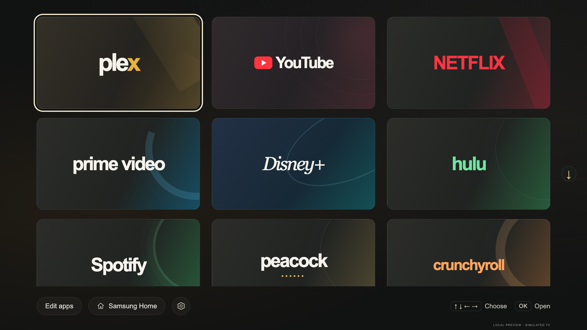
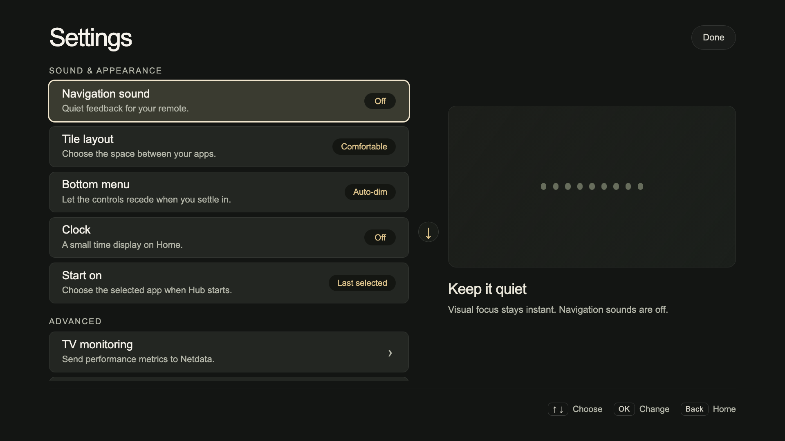
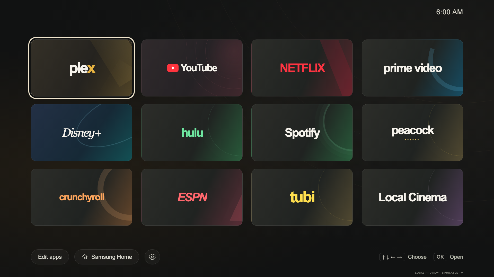
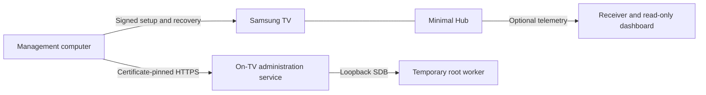

# Couchroot

**Your couch. Your TV. Your launcher.**

A minimal Samsung Tizen launcher, a read-only TV inspector, and an experimental
on-TV root agent. Built through hands-on work with a QN90A and an S90D.

[Get started](#try-the-launcher-on-your-computer) · [Choose a launcher](docs/guides/choosing-a-launcher.md) · [Installer](docs/guides/universal-installer.md) · [TV setup](docs/guides/tv-setup.md) ·
[Root agent](research/autonomous-root/README.md) · [Sources & credits](CREDITS.md) ·
[0BSD license](LICENSE)



*Actual launcher source running in the local browser workbench with simulated
apps. Screenshots contain no live device data.*

## What's here

- **Minimal Hub:** an offline, remote-first launcher with editable favorites,
  move/remove controls, compact layout, clock, settings and a Samsung Home fallback.
- **Native Hub (experimental, QN90A):** the same home screen drawn directly with the
  TV's EFL libraries from the earliest boot hook, reaching a rendered Hub in about
  **9–10 seconds** after a reboot instead of 37–47 seconds. See
  [choosing a launcher](docs/guides/choosing-a-launcher.md) and
  [QN90A boot performance](docs/devices/qn90a/boot-performance.md).
- **TV inspector:** read-only app, process and startup inspection alongside the
  telemetry dashboard. See [telemetry and inspection](docs/guides/telemetry.md).
- **Autonomous root agent:** a separate signed service that reacquires a temporary
  root context through TV-local SDB. It uses certificate-pinned HTTPS, authenticated
  loopback messages, bounded retries and a durable request journal.
- **Setup and recovery tools:** explicit device profiles, firmware/hash checks,
  signature verification, private configuration, backups and recovery journals.
- **Research:** documented experiments, including failures and model differences.

## A quieter home screen



Use the remote's arrows to choose, OK to open, and Back to return. Favorites are
editable from the TV. The Samsung Home shortcut remains available.



## Web Hub or native Hub?

Couchroot ships two launchers with the same job: a quiet, remote-first home screen
that opens your apps. They are separate implementations because one TV's firmware
starts web apps too late for a web launcher to feel like Home.

| | Web Hub (`web/`) | Native Hub (`native-hub/`) |
| --- | --- | --- |
| Built with | HTML/JS in Samsung's Tizen web runtime | C on the TV's EFL (Ecore/Evas) libraries; no web or .NET host |
| TVs | S90D and QN90A | QN90A (firmware 2301.1) only |
| Install | Signed Tizen app via `./tv-setup` | Experimental boot hook + root agent |
| Becomes Home by | Samsung's Home/startup assignment (S90D) or the ISP source role (QN90A) | Boot hook dispatch and an overridable Home key grab |
| Hub after reboot | S90D: Samsung starts it at ~2 s. QN90A: ~37–47 s | QN90A: ~9–10 s |
| Preferences | Web app storage | Separate native file; one-time import from the web Hub, independent afterwards |
| Features | Complete | Core launcher; sound, hold-OK, fade, telemetry and saver stay in the web Hub |
| Maturity | Supported source release | Experimental research launcher |

### Why two implementations

- **The web Hub is the default.** It is a normally signed app that uses only Samsung's
  app APIs, runs on both TVs, and carries the full feature set. On the S90D, Samsung
  starts it early by itself, so there is nothing to speed up.
- **The QN90A can't start it early.** A web app cannot launch before the firmware's web
  application service is ready, 17–40 seconds into boot, so the best web path reaches
  the screen at 37–47 s. Optimizing the web code can't remove that delay.
- **The native Hub avoids the web runtime.** It is started from the earliest writable
  boot hook and draws with the same EFL and graphics libraries that Live TV already
  loads, which gets the Hub on screen in about 9–10 s. It needs root, runs as an unregistered window
  from a read-only view (this firmware rejects execution from writable paths), and
  depends on one firmware's boot sequence. That is why it stays experimental and
  QN90A-only rather than replacing the web Hub.
- **The two are designed to run together.** On a native-Hub TV, keep the web Hub installed: it is the
  manual fallback, holds the ISP source role the QN90A's quiet boot depends on, and
  keeps the web-only features.

Most people should use the **web Hub**. Choose the native Hub only for a QN90A where
boot-to-Hub time matters and you accept an experimental, root-dependent boot path.
The [launcher guide](docs/guides/choosing-a-launcher.md) covers the trade-offs, the
QN90A Live TV safeguards, and [how the boot time was cut](docs/devices/qn90a/boot-performance.md).

## Command-line installer

Start with an offline recipe for either launcher:

```sh
./couchroot-install plan --device qn90a --launcher native
./couchroot-install plan --device s90d --launcher web
```

The [unified installer](docs/guides/universal-installer.md) prepares review bundles
for both launchers and installs them through the shared journaled setup engine.
Native requires an enrolled QN90A baseline and root agent; its install/recovery
backend is offline-tested only. Preparation does not install or contact a TV.

## Try the launcher on your computer

No TV, signing certificate or root access is needed for the browser preview.
Requires Node.js 20+ and npm.

```sh
git clone https://github.com/splitcipher/couchroot.git
cd couchroot
npm ci
npm run dev
```

Open <http://127.0.0.1:8766>. Select a scenario, click the preview, then use arrow
keys, Enter and Escape. The workbench serves the same `web/` source as the TV
package, with simulated platform APIs. It does not contact a TV or NAS.

For screenshots and browser tests:

```sh
npx playwright install chromium
npm test
npm run screenshots
```

See [UI development](docs/guides/ui-development.md) for scenarios and remote-navigation
checks. Python 3 is also required to build an unsigned package with `npm run package`.

## Putting it on a TV

Start with the [setup guide](docs/guides/tv-setup.md), [compatibility notes](docs/guides/device-compatibility.md)
and [recovery guidance](docs/guides/tv-setup.md#apply-interruption-and-recovery). If you already have an installation,
use the separate [UI deployment guide](docs/guides/ui-deployment.md).

You supply your own device addresses, Developer Mode setup, SDK tools and signing
credentials. Examples use reserved addresses. Site/trust files, keys, certificates,
signed packages and deployment journals stay outside Git. Native helpers use the
.NET SDK pinned in `global.json` and Python dependencies in `tvsetup/requirements.txt`.

**Experimental source release, not a universal installer or firmware jailbreak.**
Only exact reviewed profiles are intended for device operations. Samsung signing
privileges, SDK admission and startup behavior can vary by firmware. Root does
not bypass every SMACK, DRM or firmware restriction.

| Hardware | Recorded root-agent firmware | Observed behavior |
| --- | --- | --- |
| QN90A | `T-NKM2AKUC-2301.1` | Reboot startup, root acquisition, worker and registered-service recovery |
| S90D | `T-PTMDAKUC-0090-2130.0` | Reboot startup, root acquisition, worker and registered-service recovery |

These observations are not a promise for every size, region or firmware.
The [agent notes](research/autonomous-root/README.md) record exact tests and limits,
including remaining cold-power and recovery cases. Comprehensive installation
acceptance remains work in progress; see [release readiness](docs/project/release-readiness.md).

## How the pieces fit



The root agent is separate from the launcher and dashboard. A boot service
reacquires privileges; it does not permanently patch the firmware. If the service
cannot start while Developer Mode points to loopback, recovery can require the
remote: restore Host PC IP to your management computer and restart. Read the
[agent recovery instructions](research/autonomous-root/README.md) before enabling it.

## Repository map

| Path | Purpose |
| --- | --- |
| `web/` | Web Hub: the shipped launcher UI and platform adapters |
| `native-hub/` | Native Hub (experimental, QN90A): C/EFL launcher, card styles, profiler |
| `preview/` | Local browser workbench, fixtures and screenshot capture |
| `tv-setup`, `deploy-ui`, `tvsetup/` | Setup, signing integration, deployment and recovery |
| `tools/qn90a/`, `tools/s90d/` | One-shot, model-guarded device tools (Home routing, cleanup, casting, splash) |
| `tools/dotnet/` | .NET helpers those tools build and run on the TV |
| `scripts/` | Packaging, signing, reproducibility, dependency and privacy checks |
| `research/autonomous-root/` | Agent, client, payload sources and upstream provenance |
| `research/s90d-telemetry/` | Shared collector, inspector, receiver and dashboard |
| `research/` (other) | Experiment sources referenced by the device records |
| `docs/` | [Index](docs/README.md): guides, per-device records, research and project notes |
| `tests/` | Offline UI, native, protocol, setup and recovery tests |
| `examples/` | Public configuration templates |

Historical research scripts are not the supported setup entry point. The telemetry
folder's original model name is retained even though the integration serves both TVs.

## Security and contributions

Use only with devices you own or administer. Keep management endpoints on a trusted
network. Never post raw logs, device identifiers, keys or signing material in issues.
See [Security](SECURITY.md) and [Contributing](CONTRIBUTING.md).

This repo starts from a reviewed source snapshot rather than the development Git
history. See the [publication review](docs/project/publication-review.md) for what was checked
and the limits of those checks.

## License and thanks

Original Couchroot work is **[0BSD](LICENSE)**: use it with or without attribution.
Bundled third-party code retains its own licenses, including Vetro's MIT notices.
See [licensing details](LICENSE-STATUS.md).

Thanks especially to [Vetro](https://github.com/andrearicci93/vetro) and
[samsung-tv-root](https://github.com/chris-ritsen/samsung-tv-root) for the transport,
root payloads and research that helped make this possible. [Sources & Credits](CREDITS.md)
records included code, development references and tools.

Unofficial; not endorsed or supported by Samsung. Product names and marks belong
to their respective owners.
