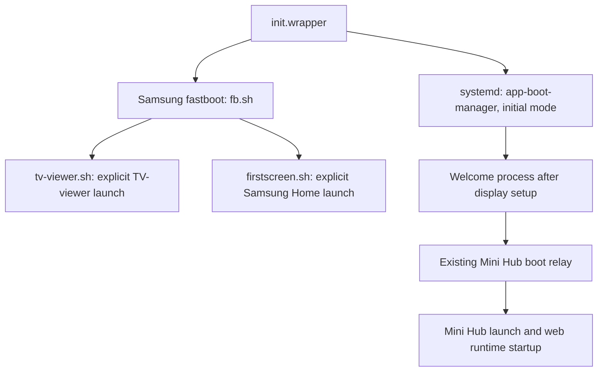

# Why Mini Hub did not replace Live TV at cold boot

Investigation: 2026-09-22, QN85QN90AAFXZA, T-NKM2AKUC-2301.1.
Read-only SDK inspection and offline ARM/.NET reverse engineering. No settings,
packages, services, firmware or routing were changed; no reboot was requested.

**The failed first-screen preference trial targeted the wrong startup path.**
Samsung's early scripts explicitly launch TV-viewer and Samsung Home. The boot
manager's configurable first-screen launch is skipped on initial/full boot.
The current Mini Hub relay adds a later launch; it does not replace either early
script. This explains why saving the Hub ID successfully did not make Hub the
initial app.

## Confirmed startup chain



These paths overlap; the diagram is a dependency/dispatch map, not a serial
timeline. Samsung Home being started does not mean its window is shown.

### 1. Live TV is an explicit early launch

Live `/usr/apps/fastboot/bin/fb.sh` starts `/usr/bin/tv-viewer.sh` unless its
`SKIP_TV_VIEWER_SH` environment variable is set. The viewer script calls:

```sh
app_launcher -f org.tizen.tv-viewer cmd init -u "$USER_ID"
```

It retries every 50 ms until the output reports a successful launch. It does not
read `db/first_screen/type`, `db/appfw/home_appid`, or Mini Hub's routing rows.
`init.wrapper` launches fastboot before it execs systemd. Merely changing an
application preference cannot remove this explicit launch request.

The previous measured viewer/context-manager start times of 1.376/2.740 seconds
are therefore consistent with the script chain and the failed viewer-event
hooks. Those timings are from the [earlier boot trials](../research/qn90a-hub-boot/README.md),
not a new reboot during this investigation.

### 2. Initial boot deliberately skips the configurable first-screen job

Fresh Ghidra disassembly of the exact installed `app-boot-manager` confirms:

| Location | Verified behavior |
| --- | --- |
| `main`, `0x131a0`; instructions `0x13212–0x13214` | Normal invocation passes zero to `boot_mode_init`. Resume has a separate argument/FD path. |
| `boot_mode_init`, `0x16130` | Saves that initial/resume parameter in `0x2f248`. |
| Mode table `0x2f1f0` | Mode 2 points to Thumb callback `0x19275`, function entry `0x19274`. |
| `boot_mode_do_next`, `0x15e6c` | Invokes the selected mode callback with the saved initial/resume parameter. |
| `0x19846–0x19852` in `0x19274` | If that parameter is zero, forces the first-screen-launch condition false and branches past the preference getter. |
| `0x19856` | Only the permitted path calls `mgr_util_get_firstscreen_appid` (`0x13ba4`), which reads `db/first_screen/type`. |

Simplified semantics, omitting the other wake/product gates:

```text
should_launch_configured_firstscreen = eligible_autostart_condition
if initial_boot:
    should_launch_configured_firstscreen = false
if should_launch_configured_firstscreen:
    launch(read("db/first_screen/type"), entry_point="booting")
else:
    enqueue_dummy_job()
```

Thus `auto_start=1` does not override the initial-boot gate. This is an
instruction-level check, not just an interpretation of imperfect decompiler
variable names.

### 3. Samsung Home has its own cold-boot visibility policy

Live `/usr/bin/firstscreen.sh` explicitly starts `com.samsung.tv.csfs` with
`entry_point=cold_booting`, retrying until launch succeeds. It does not substitute
the app named by `db/first_screen/type`.

The exact TV's `csfs.dll` was copied with matching SHA-256 and decompiled.
`CsfsShowController.CheckShowStatus` recognizes `cold_booting`, reads
`FSConfigAdapter.IntKey.SmartHubAutoStart` (35), and decides whether to show or
hide **Samsung Home's own window**. With autostart disabled, the cold-boot path
signals first-screen readiness and returns `Hide`. Other gates include setup
wizard, Ambient mode and model-specific conditions. Passing these checks returns
`Show`; it does not launch a replacement app.

The key mapping was independently checked in the exact
`Tizen.TV.Service.CoBA.Common.dll`: `CommonConfig` maps `SmartHubAutoStart` to
`db/menu/smart_hub/ontvsetting/auto_start`. Its separate `FirstScreenType` key is
46. The similar `CSFS.Common.dll` has a different enum layout and must not be
used as a substitute for the actual referenced assembly.

This explains why the setting is not a Hub redirect. It does **not** establish
which visibility gate hid Samsung Home during the historical failed preference
trial: that trial lacks a contemporaneous CSFS decision log. Its confirmed
observations remain persisted settings and Live TV foreground/on the panel.

### 4. The current relay is a later handoff

The retained task rule observes `org.tizen.welcome-mode` starting and launches
`MiniHubBoot.Start`. It does not cancel TV-viewer or rewrite Samsung's first
launch. The relay then waits for stable boot readiness and makes a bounded Hub
request. This behavior is intentional in the current implementation.

The prior `control-one` boot provides a same-run cross-check: TV-viewer signaled
its show-complete event at 4.547 s, the relay entered at 17.98 s, requested Hub at
25.26 s and confirmed native Hub foreground at 44.20 s. These are process/event
and framework observations, not direct panel-pixel timings.

## Other apparent shortcuts

| Candidate | What the code/evidence actually says |
| --- | --- |
| Change `home_appid` | The context-manager library uses this value for base-window ordering and overlay behavior (`listen_run`, `listen_pause`, `base_wind_init`). It would not remove the explicit TV-viewer request in `tv-viewer.sh`. A complete home-app replacement has not been tested. |
| Enable last-app boot | A separate initial-mode recovery branch checks `db/menu/app_booting`, rotation eligibility, two product feature flags, a nonempty `db/volt/last_service_app_booting`, and `device_power_get_state()==2`. Its own diagnostic identifies this as background-standby recovery. It is not an unconditional cold-start target. Current readback is app_booting=0 and an empty saved app. Product feature values were not queried in this investigation. |
| Enable signage autorun | This is a distinct product-feature-gated business-app path, not evidence of supported consumer-TV Hub startup. Current autorunsignage is 0. |
| Set `SKIP_TV_VIEWER_SH` | Fastboot has this branch, but the inspected inputs are inherited environment and `/tmp/special_boot.env`. Initial startup recreates `/tmp`; no supported persistent way to supply this override was established. Suppression alone would not launch Hub. |
| Disable viewer entirely | Existing boot logs show HDMI-CEC and other services waiting for viewer readiness, and the boot manager observes viewer show completion. Removing it requires dependency analysis, not merely hiding the Live TV window. |

## Result and next engineering boundary

The first-screen-preference failure is explained without another reboot: the
initial script targets are fixed and the alternative native preference path is
gated off for initial boot. Repeating the same preference assignment is not a
useful next experiment.

A true first-screen replacement needs an integration point **before the viewer's
initial presentation**, while preserving the viewer's source/readiness duties and
waiting for Hub's actual runtime readiness. The next reverse-engineering target
is TV-viewer's handling of `cmd=init`, `/tmp/cb_show`, and its initial window/AV
presentation policy. Determine whether a supported background-init mode exists
before considering any startup suppression. No such mode is established here.

The subsequent [viewer background-startup investigation](samsung-qn90a-viewer-background.md)
identified the native background initialization path, its early mode-file
selection and deferred readiness behavior. It did not establish a supported
persistent override or a deployable bypass.

Skipping the visible Live TV frame and making the web app ready sooner are
separate outcomes. The [web startup measurements](samsung-qn90a-web-startup.md)
still do not support a promised cold-boot speedup from suppressing the viewer.

## Evidence and verification

Private evidence:
`~/.local/share/samsung-tv-research/qn90a/direct-boot-review/20260922/`.
It contains live script/settings captures, checksum-verified assemblies, .NET
decompilation/IL, native disassembly, and verification results. Raw firmware and
logs remain outside Git.

| Artifact | SHA-256 |
| --- | --- |
| `app-boot-manager` | `75fee7b2729dae58e458831e330aeb1286fe5cc5cf510588570eb5c8b8d2e4f8` |
| `init.wrapper` | `7770296e005c6fe55d2d2adb060e040d475936c4e3bf3a3a8879030c325d235a` |
| `fb.sh` | `4673ca77c9693c031fa1d7b5bbd7c772cd78271f4a71f8a3cfa04907996256c3` |
| `tv-viewer.sh` | `c2c9e1d55c5e391f8a715311fd09aeec72629a81a09414794e67c6fc9c8193f3` |
| `firstscreen.sh` | `4b597b2563971735c078924a221be71ee51f3513db8f6b3eda5f31fef6ad0c84` |
| `csfs.dll` | `231ec5580ad50d68c8846787bdab0f0ee9824b9563087b69cea3cae99800e6da` |
| `Tizen.TV.Service.CoBA.Common.dll` | `7381da9da00ee0a7e499e5fec690f3f341466d98e7e7c4dc8bb23c0edbd2464c` |
| `libapp-context-manager-common.so` | `b3ab74351b37df5e18b1b3a2c888e6bc2de92c67123dd98687c9538adcfa4894` |

The boot manager, init wrapper, routing library and two principal .NET assemblies
were verified against live hashes after analysis. Boot ID and the inspected
preferences remained unchanged. Asteroids was foreground at both the first and
last readback; it was not interrupted. This was static/read-only validation,
not a new bypass or boot-time trial.
