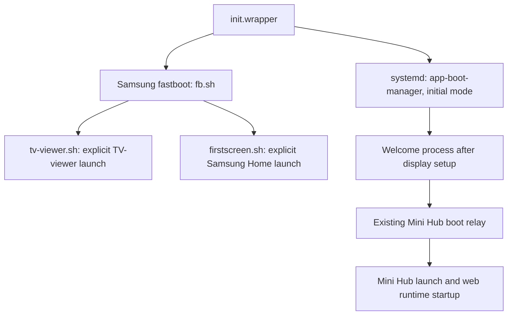

# Why Mini Hub did not replace Live TV at cold boot

Investigation: 2026-09-22, QN85QN90AAFXZA, T-NKM2AKUC-2301.1.
Read-only SDK inspection and offline ARM/.NET reverse engineering. No settings,
packages, services, firmware or routing were changed; no reboot was requested.

**The failed first-screen preference trial targeted the wrong startup path.**
Samsung's early scripts explicitly launch TV-viewer and Samsung Home. The boot
manager's configurable first-screen launch is skipped on initial/full boot.
The current Mini Hub relay adds a later launch; it does not replace either early
script. This explains why saving the Hub ID successfully did not make Hub the
initial app.

## Confirmed startup chain



These paths overlap; the diagram is a dependency/dispatch map, not a serial
timeline. Samsung Home being started does not mean its window is shown.

### 1. Live TV is an explicit early launch

Live `/usr/apps/fastboot/bin/fb.sh` starts `/usr/bin/tv-viewer.sh` unless its
`SKIP_TV_VIEWER_SH` environment variable is set. The viewer script calls:

```sh
app_launcher -f org.tizen.tv-viewer cmd init -u "$USER_ID"
```

It retries every 50 ms until the output reports a successful launch. It does not
read `db/first_screen/type`, `db/appfw/home_appid`, or Mini Hub's routing rows.
`init.wrapper` launches fastboot before it execs systemd. Merely changing an
application preference cannot remove this explicit launch request.

The previous measured viewer/context-manager start times of 1.376/2.740 seconds
are therefore consistent with the script chain and the failed viewer-event
hooks. Those timings are from the [earlier boot trials](../research/qn90a-hub-boot/README.md),
not a new reboot during this investigation.

### 2. Initial boot deliberately skips the configurable first-screen job

Fresh Ghidra disassembly of the exact installed `app-boot-manager` confirms:

| Location | Verified behavior |
| --- | --- |
| `main`, `0x131a0`; instructions `0x13212–0x13214` | Normal invocation passes zero to `boot_mode_init`. Resume has a separate argument/FD path. |
| `boot_mode_init`, `0x16130` | Saves that initial/resume parameter in `0x2f248`. |
| Mode table `0x2f1f0` | Mode 2 points to Thumb callback `0x19275`, function entry `0x19274`. |
| `boot_mode_do_next`, `0x15e6c` | Invokes the selected mode callback with the saved initial/resume parameter. |
| `0x19846–0x19852` in `0x19274` | If that parameter is zero, forces the first-screen-launch condition false and branches past the preference getter. |
| `0x19856` | Only the permitted path calls `mgr_util_get_firstscreen_appid` (`0x13ba4`), which reads `db/first_screen/type`. |

Simplified semantics, omitting the other wake/product gates:

```text
should_launch_configured_firstscreen = eligible_autostart_condition
if initial_boot:
    should_launch_configured_firstscreen = false
if should_launch_configured_firstscreen:
    launch(read("db/first_screen/type"), entry_point="booting")
else:
    enqueue_dummy_job()
```

Thus `auto_start=1` does not override the initial-boot gate. This is an
instruction-level check, not just an interpretation of imperfect decompiler
variable names.

### 3. Samsung Home has its own cold-boot visibility policy

Live `/usr/bin/firstscreen.sh` explicitly starts `com.samsung.tv.csfs` with
`entry_point=cold_booting`, retrying until launch succeeds. It does not substitute
the app named by `db/first_screen/type`.

The exact TV's `csfs.dll` was copied with matching SHA-256 and decompiled.
`CsfsShowController.CheckShowStatus` recognizes `cold_booting`, reads
`FSConfigAdapter.IntKey.SmartHubAutoStart` (35), and decides whether to show or
hide **Samsung Home's own window**. With autostart disabled, the cold-boot path
signals first-screen readiness and returns `Hide`. Other gates include setup
wizard, Ambient mode and model-specific conditions. Passing these checks returns
`Show`; it does not launch a replacement app.

The key mapping was independently checked in the exact
`Tizen.TV.Service.CoBA.Common.dll`: `CommonConfig` maps `SmartHubAutoStart` to
`db/menu/smart_hub/ontvsetting/auto_start`. Its separate `FirstScreenType` key is
46. The similar `CSFS.Common.dll` has a different enum layout and must not be
used as a substitute for the actual referenced assembly.

This explains why the setting is not a Hub redirect. It does **not** establish
which visibility gate hid Samsung Home during the historical failed preference
trial: that trial lacks a contemporaneous CSFS decision log. Its confirmed
observations remain persisted settings and Live TV foreground/on the panel.

### 4. The current relay is a later handoff

The retained task rule observes `org.tizen.welcome-mode` starting and launches
`MiniHubBoot.Start`. It does not cancel TV-viewer or rewrite Samsung's first
launch. The relay then waits for stable boot readiness and makes a bounded Hub
request. This behavior is intentional in the current implementation.

The prior `control-one` boot provides a same-run cross-check: TV-viewer signaled
its show-complete event at 4.547 s, the relay entered at 17.98 s, requested Hub at
25.26 s and confirmed native Hub foreground at 44.20 s. These are process/event
and framework observations, not direct panel-pixel timings.

## Other apparent shortcuts

| Candidate | What the code/evidence actually says |
| --- | --- |
| Change `home_appid` | The context-manager library uses this value for base-window ordering and overlay behavior (`listen_run`, `listen_pause`, `base_wind_init`). It would not remove the explicit TV-viewer request in `tv-viewer.sh`. A complete home-app replacement has not been tested. |
| Enable last-app boot | A separate initial-mode recovery branch checks `db/menu/app_booting`, rotation eligibility, two product feature flags, a nonempty `db/volt/last_service_app_booting`, and `device_power_get_state()==2`. Its own diagnostic identifies this as background-standby recovery. It is not an unconditional cold-start target. Current readback is app_booting=0 and an empty saved app. Product feature values were not queried in this investigation. |
| Enable signage autorun | This is a distinct product-feature-gated business-app path, not evidence of supported consumer-TV Hub startup. Current autorunsignage is 0. |
| Set `SKIP_TV_VIEWER_SH` | Fastboot has this branch, but the inspected inputs are inherited environment and `/tmp/special_boot.env`. Initial startup recreates `/tmp`; no supported persistent way to supply this override was established. Suppression alone would not launch Hub. |
| Disable viewer entirely | Existing boot logs show HDMI-CEC and other services waiting for viewer readiness, and the boot manager observes viewer show completion. Removing it requires dependency analysis, not merely hiding the Live TV window. |

## Result and next engineering boundary

The first-screen-preference failure is explained without another reboot: the
initial script targets are fixed and the alternative native preference path is
gated off for initial boot. Repeating the same preference assignment is not a
useful next experiment.

A true first-screen replacement needs an integration point **before the viewer's
initial presentation**, while preserving the viewer's source/readiness duties and
waiting for Hub's actual runtime readiness. The next reverse-engineering target
is TV-viewer's handling of `cmd=init`, `/tmp/cb_show`, and its initial window/AV
presentation policy. Determine whether a supported background-init mode exists
before considering any startup suppression. No such mode is established here.

The subsequent [viewer background-startup investigation](samsung-qn90a-viewer-background.md)
identified the native background initialization path, its early mode-file
selection and deferred readiness behavior. It did not establish a supported
persistent override or a deployable bypass.

Skipping the visible Live TV frame and making the web app ready sooner are
separate outcomes. The [web startup measurements](samsung-qn90a-web-startup.md)
still do not support a promised cold-boot speedup from suppressing the viewer.

## Evidence and verification

Private evidence:
`~/.local/share/samsung-tv-research/qn90a/direct-boot-review/20260922/`.
It contains live script/settings captures, checksum-verified assemblies, .NET
decompilation/IL, native disassembly, and verification results. Raw firmware and
logs remain outside Git.

| Artifact | SHA-256 |
| --- | --- |
| `app-boot-manager` | `75fee7b2729dae58e458831e330aeb1286fe5cc5cf510588570eb5c8b8d2e4f8` |
| `init.wrapper` | `7770296e005c6fe55d2d2adb060e040d475936c4e3bf3a3a8879030c325d235a` |
| `fb.sh` | `4673ca77c9693c031fa1d7b5bbd7c772cd78271f4a71f8a3cfa04907996256c3` |
| `tv-viewer.sh` | `c2c9e1d55c5e391f8a715311fd09aeec72629a81a09414794e67c6fc9c8193f3` |
| `firstscreen.sh` | `4b597b2563971735c078924a221be71ee51f3513db8f6b3eda5f31fef6ad0c84` |
| `csfs.dll` | `231ec5580ad50d68c8846787bdab0f0ee9824b9563087b69cea3cae99800e6da` |
| `Tizen.TV.Service.CoBA.Common.dll` | `7381da9da00ee0a7e499e5fec690f3f341466d98e7e7c4dc8bb23c0edbd2464c` |
| `libapp-context-manager-common.so` | `b3ab74351b37df5e18b1b3a2c888e6bc2de92c67123dd98687c9538adcfa4894` |

The boot manager, init wrapper, routing library and two principal .NET assemblies
were verified against live hashes after analysis. Boot ID and the inspected
preferences remained unchanged. Asteroids was foreground at both the first and
last readback; it was not interrupted. This was static/read-only validation,
not a new bypass or boot-time trial.


## Supervised ISP-source + autonomous-agent trial — 2026-10-11

A subsequent trial reached Hub automatically without Live TV picture or sound.
The owner watched the reboot, confirmed no remote buttons were pressed before
Hub appeared, and verified that Hub responded afterward. **The blank startup
lasted roughly two minutes.** This is one supervised native reboot on the same
QN90A firmware, not a claim about AC removal, repeated boots or standby resume.

The installed Hub 0.4.14 uses the same application payload as 0.4.13, with only
the forward version and `D2TV=ISPBound` manifest metadata changed. Normal signed
installation registered the ISP role. A fresh native WAS source launch returned
callbacks 900/901/902 and saved `isp-service` with `MiniHub001.Hub`; resuming an
already-running app was not used as source-registration evidence.

The optional QN90A boot action in administration service 0.1.6 launches the
existing signed `MiniHubBoot.Start` relay after authenticated local root returns.
It claims one attempt per boot, refuses another app's foreground, and submits
no new launch after 110 seconds. The existing relay retains its power/readiness
checks. No firmware binary, startup readiness marker or viewer process was
patched or replaced.

Observed on the accepted boot:

| Evidence | Result |
| --- | --- |
| Viewer initialization mode | `init_mode_background` |
| Relay entry | 107.57 seconds uptime |
| One Hub launch request | 114.69 seconds uptime |
| Relay confirmed Hub foreground | 117.69 seconds uptime |
| Physical panel | Blank wait, then interactive Hub; no Live TV picture/audio |
| Autonomous root | Returned with loopback Developer Mode retained |

The agent's own status reached `deadline` before the relay completed. That
status describes its 110-second observation window; the later relay report,
fresh foreground readback and owner's observation establish the final result.
It should not be presented as an early successful startup or as a launch failure.
The long delay and status-window mismatch remain follow-up work.

An earlier same-session task-filter experiment linking the root service start
to the relay did not demonstrate a launch and was reverted before this reboot.
The original welcome route remains intact. S90D was not changed.

Recovery material retains the signed 0.4.15 inverse (same Hub payload, ISP role
removed), original source preferences, package backups and frozen setup source.
Recover through the shared source trial, then restore the saved source slots;
do not treat package rollback alone as source-preference restoration. If the
agent is unavailable, restore the PC's Developer Mode host using the remote and
restart to recover SDK access. Private journals retain the site-specific details.

Validation: 206 setup tests and 13 autonomous-agent/boot-action tests passed.
The final snapshot verified that only Hub's manifest changed among the tracked
baseline files. The QN90A configuration is retained; further power transitions
require their own observations.


## Startup queue investigation — 2026-10-11

The ISP-source path starts the web-app runtime early: the measured systemd
process start was 9.61 seconds and active/readiness timestamp 14.87 seconds.
Welcome mode was running at about 14 seconds, but the administration service
was not launched until about 104 seconds. Thus the earlier normal-source
35–41 second web-runtime schedule does not explain this boot's long blank wait.

Adding a `launch` event alongside the existing welcome `start` task rule did
not help: the root fallback relay entered at 109.08 seconds and confirmed Hub
at 118.19 seconds. The extra rule was rolled back. No earlier autonomous relay
entry was demonstrated.

The installed `/usr/lib/libamd.so.1.27.7` was matched byte-for-byte to the local
firmware corpus (SHA-256
`aba2ac6d1b88db0b5d4f245f0216ce8861c1049584d780e39a60be0877b0b832`).
Offline analysis confirms a 90-second user-login fallback timer in
`FUN_410614e8`; its callback `FUN_41061f4c` activates the user after checking
that `/opt/usr` is mounted. This strongly fits the observed delayed application
startup, but the callback was not dynamically traced. Do not describe a static
match as direct evidence of which boot condition failed.

The same library reads `http://tizen.org/metadata/on-boot/priority`, clamps it
to 1–99, and sorts the on-boot service queue by descending priority. A separate
shared-engine trial adds priority 99 only to `MiniRoot01.Service`'s own metadata.
It uses a consistent package-database backup, guarded transaction, exact inverse,
and the existing device lock/journal. Host SQLite checks covered forward apply,
inverse restoration and rejection of conflicting metadata. It does not alter
boot-ready values, native binaries, the vendor queue timer, ISP source settings,
or any S90D configuration.

The first priority boot confirmed Hub at 109.63 seconds (relay entry 99.10),
about eight seconds better than the 117.69-second baseline. The root agent's
own handoff status also reached `foreground-confirmed`. The viewer remained in
background initialization and the ISP source values were retained. This trial
was remotely observed while the owner was away; no new physical panel/audio
acceptance is claimed. The original owner's no-Live-TV observation applies to
the earlier baseline boot.

This priority is a tested local registration override, not metadata already
present in the signed 0.1.6 package. A future package installation may remove
it, just as it may reset the previously adjusted on-boot flags. Preserve or
reapply only through a reviewed setup operation; do not assume an update keeps
it. The long vendor startup wait remains unresolved.


The repeat priority boot confirmed Hub at **109.61 seconds**, with relay entry
99.47 seconds and one accepted launch. The priority setting is retained after
two closely matching boots, approximately eight seconds faster than baseline.
Final verification confirmed authenticated root, fresh telemetry, the original
welcome/Home routes, unchanged tracked application/protected files, background
initialization, and the saved ISP source. No setup journal remains pending.
This is an incremental queue improvement; the roughly 90-second wait still
prevents a substantially earlier Hub display.


## Fallback research: failed target-completion services — 2026-10-11

Three Luna research passes examined exact-firmware AMD login handling, native
startup readiness, and alternative launch paths. Additional read-only inspection
of the retained priority-99 boot found a more concrete fault than the static
90-second timer alone:

- `system-default-target-done.service` failed with exit status 1 while invoking
  `/usr/bin/touch /run/systemd/system/graphical.target.done`.
- `system-delayed-target-done.service` likewise failed with exit status 1 while
  invoking `/usr/bin/touch /run/systemd/system/delayed.target.done`.
- The delayed target itself activated at 55.796 seconds. Its completion service
  failed at 55.817 seconds. `booting-done.service` ran from 55.796 to 85.976 seconds,
  consistent with its separate 30-second completion wait.
- The captured `memory/sysman/booting_status=3` is the timeout value explicitly
  written by the firmware's `wait-delayed-target.sh`; success writes 1.
- Both system completion markers and the user delayed-target marker were absent.
  The user default-target marker existed. No system jobs remained at inspection.

Both failed system units run as `system_fw`, with `SmackProcessLabel=System`,
`SecureBits=keep-caps`, and `Capabilities=cap_dac_override=i`. Their destination
was root-owned mode 0755 with label `System::Run`. A permission/capability or
Smack failure is plausible, but exit status 1 does not establish the errno;
available unit journals contained no entries. Do not assume changing directory
permissions is the correct repair.

Exact AMD function `FUN_410582e0` handles `StartupFinished` and
`UserSessionStartupFinished`, invoking its registered startup callback only when
both have been seen. This identifies a genuine completion path to investigate.
Neither signal timing nor the per-user 90-second timer firing was captured, so
failed target completion is a strong lead, not yet a proven explanation for the
root service's late start. The missing viewer-ready marker is a separate
observation; no direct causal link from it to AMD's gate has been established.

The next discriminating investigation is to recover the failed units' error
cause and effective credentials, inspect the user delayed-target producer, and
capture both real startup signals plus AMD login transitions during an otherwise
unchanged boot. Any repair should let the original services report genuine
completion. Fabricating markers or boot-status values would hide the fault and
would not demonstrate that earlier foreground launch is safe.

Vetro's boot service provides no demonstrated faster path on this firmware.
Historical ordinary-signing normalization is distinct from our current working
`MiniRoot01.Service` registration; autonomous startup itself is already verified.
No TV configuration, package, or boot behavior was changed during this research.
The existing approximately 109.6-second configuration remains in place.


A focused read-only disassembly also located the vconf callback omitted by the
initial decompiler export, at Thumb addresses `0x41061808`–`0x4106189a`. It compares
an incoming integer with a stored boolean, stores `incoming != 0`, and activates
waiting users/cancels their login timers only when the original integer equals
the configured success value. With success value 1, a timeout value of 3 does not
activate users there; a subsequent 3-to-1 notification can be suppressed by the
boolean comparison. This is an additional reason not to attempt a late synthetic
status write. The configured success default must still be verified in exact
binary initialization before treating the value-specific interpretation as fully
resolved; the callback's control flow itself was checked against instructions.


## REA workload and live waiter diagnosis — 2026-10-11

REA 6.4.0 was configured locally with the existing Ghidra 12.1 provider. The
private workload retains per-task reports, exact REA Evidence JSON, binary
hashes, and reusable snapshots. Three Luna workers covered the two native
completion helpers, AMD defaults/notification handling, and the user unit chain.
No TV package, boot preference, service state, or readiness marker was modified.

The read-only investigation found the user delayed-target trigger still
`activating` long after Hub appeared. It started at 5.481744 seconds with an
infinite service timeout. Its first ExecStart, `wait-default-target.sh User`,
had not returned, so its second ExecStart never launched user `delayed.target`.
This explains why the user delayed marker producer was inactive rather than
failed. The user-manager status was read through its configured kdbus endpoint;
the missing ordinary Unix bus socket was not evidence of a missing manager.

REA decompilation of the firmware-matched `wait-target-done` establishes a
specific unbounded path. It creates a blocking inotify descriptor and checks
marker existence. Its outer poll loop has a 30-second monotonic deadline, but
its inner event reader keeps calling blocking `read()` while any required marker
bit remains. After a partial or irrelevant event, an empty next read can wait
indefinitely without returning to the deadline check. Watch-registration failure
also retries indefinitely before the deadline begins.

The live user waiter had a blocking inotify descriptor watching both completion
marker directories. A targeted one-byte read of its mapped pending-mask variable
returned `0x01`: only `/run/systemd/system/graphical.target.done` remained pending.
The producer of that exact marker had failed with exit status 1. This connects
the failed system marker to the stuck user startup sequence. The event which
originally entered the reader was not recorded, nor was AMD's timer firing.

The failed system marker services both discard stdout/stderr, explaining the
empty journals. Their installed capabilities are inheritable-only, their
process user is system_fw, and the destination is root-owned 0755. Permission or
capability failure remains the leading explanation, but the original errno and
execution-time credentials have not been captured. A separate non-writing
system_fw access check found the directory unwritable; its different Smack
context means it is not a complete reproduction of either service.

`send-booting-done` emits `/org/tizen/system`, interface
`org.tizen.system.Booting`, signal `BootingDone`, with int32 payload 1 when invoked
without additional arguments and 3 with any extra argument. This signal must not
be confused with the two systemd startup-finished signals AMD observes.

The best repair investigation targets the real system graphical-marker producer
and the helper's blocking-read logic. Merely synthesizing a marker, shortening
an unrelated launch delay, or repairing state after root arrives would not prove
that startup is genuinely complete or that a persistent early-boot solution
works. Current software-confirmed startup remains approximately 109.6 seconds.

Fresh REA analysis also resolves the previous AMD default-value uncertainty:
`amd_main` stores integer 1 in the success configuration field at instruction
`0x410679ea`; a parsed nonnegative override can replace it. The registration for
`startup.finished` points to Thumb code at `0x410615f4` (tagged pointer
`0x410615f5`). Full callback semantics remain open because seeded Ghidra analysis
misdecoded the body as ARM; those failed outputs were retained but not treated as
valid pseudocode. Historical source remains comparison evidence only.


## Controlled privilege reproduction — 2026-10-11

A bounded follow-up used unique transient diagnostic units and non-readiness
probe filenames, guarded by the shared QN90A lock and identity-checked transport.
The real completion producers and marker paths were not changed. Reproducing
system_fw UID/GID 202, Smack System and inheritable-only DAC override yielded
CapInh=2, CapPrm=0, CapEff=0 and an explicit `touch: Permission denied` in the
root-owned systemd directory. A root-owned probe under the same Smack label
succeeded. All owned diagnostic files/units were removed or collected afterward.
This reproduces the permission failure; it does not recover the original
services' discarded stderr. An attempted ambient-capability alternative failed
before ExecStart with status 218 on kernel 4.1.10 and was not retained.

The narrow candidate correction is User=root for both system-default-target-done
and system-delayed-target-done, preserving each original command and Smack label.
The default producer is essential: fixing only the delayed producer would leave
the observed graphical-marker wait blocked. Private candidate drop-ins are
prepared but **not installed**. The inspected bootstrap, generator, tmpfiles and
unit paths exposed no writable persistent early override source. A late runtime
repair after autonomous root arrives would not establish a boot-time improvement.

The remaining AMD callback has also been recovered by a supplementary private
Ghidra pass with explicit Thumb context. It rejects non-regular UIDs, finds or
creates the user, returns if already ACTIVE, otherwise removes/clears a pending
timer, assigns state8 (ACTIVE), and dispatches user login. This confirms the
normal startup-finished path can avoid the fallback. The supplementary output is
labeled separately from canonical REA Evidence. No new cold-boot timing or
physical no-Live-TV acceptance is claimed by this diagnostic pass.


## Early completion repair — first reboot trial, 2026-10-11

A reversible private trial found an early persistent entry point in the writable
`/opt/etc/parseinfo.sh` invoked by AT-HUB. A small AWK wrapper ran the byte-exact,
backed-up Samsung script first, then installed two runtime drop-ins selecting
`User=root` for the genuine system completion producers and queued a systemd
reload. It preserved their commands, group, Smack label and manual-start guards.
It did not synthesize readiness markers or change the ISP/background startup path.
This is an experimental firmware-specific integration, not a vendor extension API.

On the first reboot the repair began at 7.48 seconds. The real graphical and
delayed marker producers exited successfully at 39.83 and 40.63 seconds. The
previously stuck user delayed-target trigger exited successfully at 39.97 seconds;
all four system/user completion markers were present. Hub was software-confirmed
in front at 61.54 seconds, compared with the prior approximately 109.61 seconds.
No manual launch was used. Physical screen/audio behavior was not observed during
this autonomous trial; ISP/background selection remained intact.

The first wrapper was then rolled back successfully to harden failure handling
before repeat validation. Readback confirmed the original Samsung file hash,
removed owned enable/drop-in files, and restored loaded unit User=system_fw.
Hub remained in front. Original backups and recovery journals stay private.
The early hook has a measured timing margin but no new dependency ordering edge;
firmware updates may replace it. This result supersedes the earlier finding that
no persistent early path had been demonstrated, but is not yet repeat validation.


### Hardened repair retained after repeat verification

The second wrapper validates both services before writing, cleans up its own
partial overrides on synchronous failure, returns failure if the vendor script
fails, and supports repeatable rollback after an interrupted restore. Four local
checks exercised shell syntax, vendor-failure handling, partial-write cleanup and
rollback retry. The installed wrapper also passed a bounded live check that
preserved vendor behavior and skipped correction once the producers were active.

Two native reboot tests with the same hardened installation then confirmed Hub
at **64.68 and 66.02 seconds**, about **40–41% faster** than 109.61 seconds. The
repair ran at 8.53 and 9.83 seconds, well before the original marker producers;
both producers and the previously blocked user trigger exited successfully.
All four genuine completion markers were verified after each reboot. No
reinstallation, external root acquisition or manual Hub launch was needed between
those two tests. The private setup run is complete and the hardened fix remains
installed on the QN90A.

ISP/background routing remains selected; the Live TV avoidance configuration was
not changed. These are software startup results, not physical screen/audio
acceptance. Persistence across ordinary native reboots is demonstrated; firmware
updates, factory resets and hard power loss remain untested. The integration is
still experimental and firmware-specific. Exact vendor backups, frozen recovery
code and operational recovery instructions remain outside the public repository.


## Remaining 66-second delay — 2026-10-11

The owner clarified that stock Live TV was fast and the new Hub boot stayed blank
until Hub; this was not a report of Live TV returning. Fresh read-only inspection
of the last verified boot places full web-app-service readiness at 16.94 seconds,
app-ready at 20.43, and display-manager readiness at 20.43. These precede
multi-user/graphical completion at 42.66 seconds.

The current route still waits for that full completion to release the on-boot
administration service (AUL start about 43.02 seconds), then waits for authenticated
root acquisition before requesting the signed Hub relay. SDB became ready at
45.08 seconds and relay entry was 55.81 seconds. Agent status showed one acquisition
attempt, so no retry backoff was observed. The relay's readiness clock began at
56.97 seconds; its five-second settle plus stable-poll rule submitted Hub at
62.97 seconds, with foreground confirmation at 66.02. This is several sequential
stages, not a single 60-second timer or a 60-second Hub page render.

Late multi-user dependencies include data-service (17.87→38.07 seconds for D-Bus
readiness), then its explicitly dependent context-aware service (38.07→42.18).
Smart Traffic Control became ready at 42.658 seconds, coincident with target
completion. These snapshots retain only latest invocations and no system journal
is available; they do not prove a fixed timeout or justify disabling those services.

The next useful experiment is to decouple the signed Hub relay request from root
acquisition and test it against actual earlier application readiness, preserving
ISP/background and foreground/power guards. Early web/display readiness is evidence
for that test, not proof Hub can already launch. No further TV changes or reboot
were made in this read-only delay investigation.


## Direct launch at application readiness — 2026-10-11

A private, reversible outer wrapper now preserves the tested completion repair
and starts a bounded early observer. It requests the existing signed Hub directly
under the owner's normal application-launch context once the real app-ready marker
exists and the web service is active. It checks ISP/background routing, active
LCD state and empty foreground, then repeats user-readable source/power/foreground
checks immediately before the request. A temporary enable flag permits rollback
to revoke a pending request. The root-based fallback remains enabled.

The first request started Hub before the administration service, but its launcher
command timed out and stopped observation prematurely. The owner confirmed a black
screen until Hub appeared and that the remote worked. A revised asynchronous
observer then measured **46.36 seconds** to Hub foreground. A final revision checked
readiness before querying configuration and measured **47.27 seconds**. Both
outcomes required no root-relay launch, compared with the previous **64.68–66.02
seconds**. These two results are from slightly different observer revisions;
byte-identical final-version repeat validation remains separate.

The retained final trial detected readiness at 24.96 seconds; the actual app-ready
service completed at 21.40 seconds. The source-check stage then consumed 8.50 seconds;
foreground/power checks and submission put the direct request at 36.83 seconds.
Hub foreground was recorded at 47.27 seconds. This identifies another measurable
cost without establishing why the configuration reads are slow. Their guards were
retained. All four genuine completion markers and ISP/background state were
verified after boot, and the temporary enable flag was cleaned up.

The final private setup run is complete. Earlier trial revisions were restored
before replacement; exact previous-wrapper backups and frozen recovery commands
remain private. The first trial has owner visual/usability confirmation; later
precise timings are software foreground observations, not physical paint or audio
measurements. No S90D, package, Live TV source or readiness-value change was made.
Firmware updates, reset, hard power loss and standby/wake remain untested for this
new hook.


## Settings-read investigation — 2026-10-11

Follow-up trials show the earlier 8.50-second interval is not specific to the source
key. After removing redundant root-context source reads, the first foreground
query took 8.91 seconds and Hub appeared at 49.86 seconds. An early read-only warm-up
completed in 0.52 seconds but the later foreground query still took 8.44 seconds;
Hub appeared at 46.80 seconds. Both experiments were restored to the prior version.

The firmware's `vconftool` is a shell wrapper around `buxton2ctl`. It performs
parsing and a daemon check before each query. Offline analysis found no fixed
8.5-second timer: the connection check opens one socket, while the synchronous get
has a 25-second response deadline. This does not establish the cause of the observed
early-boot delay. Warm reads and boot wall-clock timing are insufficient evidence;
the recorded intervals use monotonic uptime.

Direct backend queries worked when warm in both execution contexts, but an
all-native boot candidate failed its final user-context source check and exited
within a second. Its raw response was not captured. The existing root fallback
recovered Hub at 64.69 seconds and that candidate was rolled back. No failed source
check was bypassed.

A narrower candidate uses native, strictly validated foreground reads in the root
watcher and retains Samsung's wrapper for every final user-context guard. It keeps
fresh source/ISP/foreground/power checks, the revocable request marker, bounded
launch units, genuine readiness and completion producers, and the root fallback.
Its first trial reached Hub foreground at 41.81 seconds, with a 0.92-second initial
foreground read. The final source read still took 6.40 seconds. An identical-build repeat reached Hub at 45.62 seconds, with a 1.15-second initial
foreground read. Both passed all four genuine completion-marker checks, preserved
ISP/background routing, cleaned the temporary request flag, and did not need the
root relay. Autonomous root also returned healthy. The candidate is retained.
This is a modest observed gain, not a fixed five-second reduction: readiness and
boot scheduling varied, and the final guard interval still totaled 8–9 seconds.
These are software foreground times; physical paint/audio observations remain
separate. Exact private backups and frozen recovery commands restore the prior
46–47-second version. No S90D changes were made.


## Earlier preparation and native final checks — 2026-10-11

The retained successor reached Hub foreground at **36.94 and 40.51 seconds** on
identical-build native reboots. Genuine application readiness to the final launch
request fell from the prior measured 17.25 seconds to **8.37 and 7.80 seconds**.
These are software timings, not physical paint/audio observations.

Log creation, permission labels and the revocable request marker are now prepared
while waiting for readiness. The watcher uses built-in uptime reads. The redundant
root-context power query is removed; the final user-context active-LCD check stays
mandatory, along with fresh exact source/ISP/foreground checks. A final revocation
and deadline check immediately precedes exec. Genuine readiness, ISP/background
routing, the completion repair and the root fallback remain unchanged.

A failed first trial exposed a transport issue: systemd expands shell parameter
expressions in transient command arguments before the shell receives them. A live
probe reproduced it. The final native settings helper now escapes dollar signs
through that boundary, and passed a live user-context probe before boot testing.
It reads the daemon normally, validates key/layer/type and exact expected values,
and fails closed on errors. It does not cache launch authorization or add a direct
backend fallback. The two final source/ISP queries took 0.86 and 1.82 seconds.

Both retained boots verified Hub foreground, ISP/background settings, all four
genuine completion markers, request-marker cleanup and healthy autonomous root;
neither needed the root launch relay. Failed/intermediate trials were rolled back
before replacement. Exact private backups and the frozen recovery driver restore
the preceding 41.81/45.62-second version. S90D and packages were not changed.

Launch requests now occur at 28.25 and 27.40 seconds. Request-to-observed-foreground
still varied from 8.69 to 13.11 seconds. Separating app initialization, scheduling
and observation latency is the next investigation; the current evidence does not
assign that entire interval to rendering or a fixed timer.


## Optional startup-service trials — 2026-10-11

Two independent preview-updater exclusion boots reached observed Hub foreground at
36.95 and 40.06 seconds. Two targeted-advertising exclusion boots reached 39.67 and
37.98 seconds, against prior baseline 36.94/40.51. These overlapping samples do not
establish a startup speedup. The second preview trial also involved the root relay
launching first, so it is not a clean direct-launch comparison.

Preview exclusion used a reversible early runtime unit mask, since ordinary unit
"disabled" state did not prevent its boot-target activation. Both checks confirmed
the unit masked/inactive. It was restored before advertising trials. Advertising
exclusion changed only the exact app's boot/autorestart flags; both subsequent
boots confirmed the process absent while preview ran. That exclusion is retained.
All four boots verified ISP/background routing, Hub foreground and genuine system
completion markers; physical paint/audio was not newly observed.

The combined trial stopped before activation at the root agent's 1,000-operation
journal limit. Maintenance preserved the full journal on and off TV with matching
hashes, retained the unresolved intent and recent completed records in the active
journal, and reconciled temporary SDK staging. Neither interrupted nor subsequently
prepared combined configuration was activated; both setup runs were rolled back.
Preview remains enabled and targeted advertising automatic startup remains off.

A later Live TV regression coincided with saved source `vc-service` and normal
initialization, while the early-hook bytes remained unchanged. Restoring
`isp-service` recovered background initialization and Hub startup. The owner
observed black → loading spinner → Hub. The exact action that changed the saved
source was not established.

## Quiet boot launch and post-request profiling — 2026-10-11

The retained early launcher adds `__NO_LOADING_LAUNCH enable` to its existing
`app_launcher -s` request. It preserves genuine readiness, ISP/background routing,
source/power/foreground checks, revocation, deadlines, completion repair and root
fallback. No Samsung binary or signed Hub package changed. Temporary diagnostic
samplers were removed before final acceptance; exact prior-hook rollback remains.

The owner confirmed the first trial showed **no Live TV and no spinner**. Bounded
compositor samples also contained no launch-screen window. This is a boot-specific
QN90A observation, not a guarantee for every app or firmware. The older splash
module lacks the hint literal; the exact consuming component remains unresolved.
Corrected offline Thumb analysis confirms the launcher passes remaining key/value
arguments into its bundle; runtime observation establishes the visible result.

The first heavier trace reached foreground at43.59s but the launch CLI returned
failure before Hub appeared. Early compositor queries took several seconds, so
that trial is not a clean speed comparison or successful launch acknowledgement.
The lighter repeat gave these software milestones:

| Milestone | Seconds after boot |
| --- | ---: |
| Guarded launch request |24.77|
| Hub process creation |26.744|
| Launcher returns success |29.82|
| Hub observed foreground |36.67|

Thus the request-to-foreground interval was11.90s: roughly2s to process creation,
3s more to successful launcher return and6.85s more to observed foreground. During
the sampled25.60–36.07s interval, the four cores were99.54% busy,0.28% idle and0.18%
in I/O wait. Hub used6.5CPU-seconds by the sample ending36.56s. This supports CPU
contention and substantial app/runtime initialization rather than a fixed spinner
wait. It does not identify competing services or separate JavaScript, native
runtime and compositor costs. Foreground is not an exact first-painted-frame time.

The final configuration, without the samplers, launched successfully and reached
Hub foreground at42.49s,9.68s after its request. It passed source/background,
completion-marker and autonomous-root checks. Its earlier readiness stages were
later than the preceding boot. These samples do **not** establish a repeatable
speedup; the retained benefit is the owner-observed spinner-free transition.
Further timing work should identify CPU-heavy competitors during Hub initialization.
Raw firmware, traces, run journals and recovery drivers remain in private REA-18
evidence; S90D was not changed.
